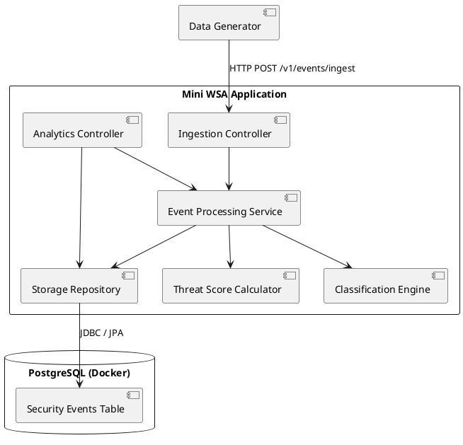
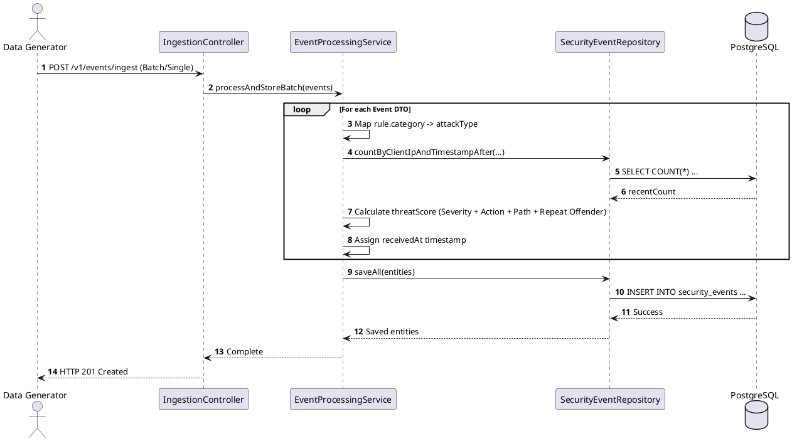

# Mini Security Analytics Pipeline — Implementation Blueprint

## Overview & Context

This document outlines my strategy, architecture choices, and step-by-step plan for completing the **Mini Web Security Analytics (Mini WSA)** take-home assignment.

The goal of this service is to mimic a core backend brain for a SOC (Security Operations Center) war room dashboard. It ingests raw DLR (Data Log Records) security events, enriches them on the fly (attack classification and dynamic threat scoring), persists them efficiently, and exposes statistics and sample data through REST APIs.

---

## Architectural Strategy & Choices

### 1. Technology Stack
* **Language/Framework:** Java 25+ with Spring Boot 4.x
    * Standard enterprise toolset offering robust web REST support, validation, and database abstraction layers.
* **API Documentation:** Springdoc OpenAPI (Swagger UI)
    * Provides interactive API documentation and auto-generated endpoints.
* **Database:** PostgreSQL running in Docker (`postgres:18-alpine`)
    * **Why PostgreSQL?** Security events consist of structured relational attributes (timestamps, status codes, action flags) alongside semi-structured JSON objects (rule metadata, geolocation details). PostgreSQL handles both structured relational joins and `JSONB` flexibility cleanly. It also supports indexing techniques (`btree` on timestamps and IPs) to keep aggregated analytics queries fast at scale.

### 2. High-Level Architecture




---

## Step-by-Step Implementation Roadmap

Below is the structured breakdown I am following to build, test, and deliver the system iteratively.

### Phase 1: Repository Setup & Foundation
* **Step 1.1:** Initialize the public GitHub repository and setup `.gitignore` for Java and IDE files.
* **Step 1.2:** Generate a Spring Boot base project containing `Spring Web`, `Validation`, `Spring Data JPA`, and `PostgreSQL Driver`.
* **Step 1.3:** Configure Springdoc OpenAPI / Swagger UI dependencies and verify UI initialization.
* **Step 1.4:** Create `docker-compose.yml` to spin up a PostgreSQL instance and define application properties (`application.yml`) to connect to it.
* **Milestone Commit Tag:** `v0.1-setup`

---

### Phase 2: Domain Models & Ingestion Layer
* **Step 2.1:** Design the `SecurityEvent` domain entities and request/response DTOs representing the DLR schema (including nested `Rule` and `GeoLocation` models).
* **Step 2.2:** Add Jakarta Validation annotations (`@NotNull`, `@Pattern`, custom enums) to enforce schema compliance on incoming requests.
* **Step 2.3:** Implement `POST /v1/events/ingest` supporting both single event objects and lists of events.
* **Step 2.4:** Inject server-side timestamp processing (`receivedAt`) onto incoming payloads prior to storage.
* **Milestone Commit Tag:** `v0.2-ingestion`

---

### Phase 3: Classification & Enrichment Logic
* **Step 3.1:** Implement category-to-attack-type mapping (`INJECTION` $\rightarrow$ "SQL/Command Injection", `XSS` $\rightarrow$ "Cross-Site Scripting", etc.).
* **Step 3.2:** Build the dynamic threat score evaluation algorithm (0 to 100 max score):
    * Base severity addition (`CRITICAL` +40, `HIGH` +30, `MEDIUM` +20, `LOW` +10).
    * Action adjustment (`DENY` +20, `ALERT` +10, `MONITOR` +0).
    * Target path bonus (+15 if path contains `/admin` or `/login`).
    * Repeat offender rule (+15 if > 5 events received from the same `clientIp` within the previous 10 minutes).
* **Step 3.3:** Persist fully enriched records into PostgreSQL.
* **Milestone Commit Tag:** `v0.3-enrichment`

---

### Phase 4: Analytics & Query APIs
* **Step 4.1:** Implement `GET /v1/stats/summary`:
    * Add filtering by `configId` and date range (`from` and `to`).
    * Calculate aggregated counts and average threat scores grouped by `category` and `action`.
    * Construct SQL queries to fetch the **Top 10 Attackers** (by `clientIp`) and **Top 10 Targeted Paths**.
* **Step 4.2:** Implement `GET /v1/events/samples`:
    * Build multi-criteria queries supporting optional filters (`configId`, `category`, `action`, time range).
    * Implement pageable offset and limit sorting descending by event timestamp.
* **Milestone Commit Tag:** `v0.4-analytics`

---

### Phase 5: Event Simulation & Data Generator
* **Step 5.1:** Construct a dedicated dataset generator (script or Spring component) capable of producing realistic security event streams.
* **Step 5.2:** Program simulation patterns for "attack waves" (bursts of events from single IP addresses hitting administrative endpoints) to validate repeat offender logic and top attacker stats.
* **Milestone Commit Tag:** `v0.5-generator`

---

### Phase 6: Testing, Refinement & Final Documentation
* **Step 6.1:** Write unit tests for threat score calculations, attack type mappings, and validation logic.
* **Step 6.2:** Write integration tests covering the ingestion and analytics API endpoints.
* **Step 6.3:** Benchmark queries and add PostgreSQL indexes on (`timestamp`, `received_at`, `client_ip`, `config_id`).
* **Step 6.4:** Finalize `README.md` with execution instructions, curl command examples, and key insights.
* **Final Tag:** `v1.0-release`

---

## Technical Pitfalls & Mitigation Strategies

1. **Repeat Offender Query Performance:**
    * *Challenge:* Checking event history for every ingested request can slow down throughput.
    * *Solution:* Index `(client_ip, timestamp)` in PostgreSQL to ensure the count check executes in milliseconds.
2. **Schema Flexibility vs. Aggregation Speed:**
    * *Challenge:* Storing nested data as raw JSON can make SQL aggregation slower.
    * *Solution:* Map heavily queried parameters (`clientIp`, `path`, `category`, `action`, `configId`) as top-level indexed table columns, storing optional deep attributes in `JSONB`.
3. **Data Quality & Validation Errors:**
    * *Challenge:* Batch payloads might contain mixed valid/invalid records.
    * *Solution:* Perform validation parsing up-front and return explicit 400 response detail arrays highlighting erroneous indexes or fields.

---

## How to Run Locally

Get the application, database, and test data running on your machine in a few simple steps.

### 1. Start the Infrastructure
Spin up PostgreSQL using Docker Compose:
```bash
docker compose up -d
```
### 2. Access the API Documentation
Once the Spring Boot application starts up, explore and test the endpoints interactively via Swagger UI:
- URL: http://localhost:8080/swagger-ui/index.html

### 3. Generate Test Data
Populate the database with sample security events using the provided script. 
You can customize the total number of events (-n) and batch size (-b):

```Bash
./generate_data.sh -n 10000 -b 200
```
Run `./generate_data.sh -h` to see all available configuration options.

### 4. Test with HTTP Client
Pre-configured request files are available for manual testing or API client execution:
- Path: `./http-client-plus/collection/mini-wsa`

## Architecture Trade-Offs and Production Roadmap

This document outlines the architectural decisions and trade-offs made for the take-home assessment, contrasting them with how these components would be built in a real-world, high-scale production environment.

**Real-World Priorities**: Ingestion and Storage First
If this were a production system, my primary architectural focus would be entirely on robust ingestion and proper data storage. Building complex analytics dashboards and heavy summary endpoints is secondary and comes much later in the project lifecycle.

In practice, monolithic aggregated endpoints are a bad design choice. Instead of forcing an operational service to compute heavy summaries on the fly, real systems rely on targeted, lightweight requests for specific data, or offload reporting entirely to dedicated analytical tools that query a data warehouse directly.

### 1.Ingestion Pipeline
#### Payload Envelope (/v1/events/ingest)
- Assessment Approach: The endpoint accepts a wrapper JSON envelope containing either a single event or a batch array to keep parsing straightforward.
- Production Reality: Supporting polymorphic inputs in a single REST endpoint leads to messy parsing logic and fragile schema evolution. Real APIs maintain a fixed format, typically batch-only or newline-delimited JSON, so schemas can change safely over time.

#### Synchronous vs. Asynchronous Processing
- Assessment Approach: A synchronous REST endpoint that writes directly to the database and returns an HTTP 201 Created once stored.
- Production Reality: Events should arrive through a message broker like Kafka. An API gateway or edge service pushes events to a topic, and stream processors handle enrichment and bulk writing asynchronously. Clients receive an HTTP 202 Accepted status because the ingestion work happens in the background, ensuring the client never waits on the database.

#### Batch Error Handling
- Assessment Approach: If any event in a batch fails validation or triggers a duplicate key constraint, the entire transaction rolls back and the batch is rejected with an HTTP 400 or 409.
- Production Reality: Rejecting an entire batch because of one malformed record discards valid data. Production pipelines accept valid events and route invalid ones to a dead-letter queue for inspection.

#### Timestamps
- Assessment Approach: The receivedAt timestamp is generated using the application server clock.
- Production Reality: Timestamps should be captured at the edge or broker level. Systems should track event time and ingestion time separately to properly handle late or out-of-order events.

### 2. Error Handling
- Assessment Approach: A global exception handler catches common errors like duplicates, bad requests, and missing configurations, returning clean HTTP status codes instead of generic server crashes.
- Production Reality: Clear status codes remain essential, but asynchronous ingestion pipelines replace traditional database exceptions with dead-letter routing and retry policies for transient failures.

### 3. Enrichment and Threat Scoring
#### Frequency Checks
- Assessment Approach: Checking repeat offenders by running a database count query on every incoming write. This creates performance bottlenecks and race conditions.
- Production Reality: Real systems use stateful stream processors like Kafka Streams with windowed aggregation, or maintain in-memory sliding window counters in Redis keyed by client IP.

#### Scoring Logic
- Assessment Approach: Threat scores are computed once during ingestion and stored permanently with hardcoded weights.
- Production Reality: Scoring rules change over time. Systems should version their scoring models or compute certain signals at query time so historical data can be re-scored against new rules. Configurations should be dynamic per customer or policy rather than hardcoded constants.

### 4. Analytics and Stats API
#### Aggregations
- Assessment Approach: Running GROUP BY queries directly on raw operational tables to generate summary reports.
- Production Reality: Querying millions of raw events on every dashboard refresh degrades database performance. Production systems use pre-aggregated rollups in data warehous (ClickHouse etc.).

#### Top-K Attackers and Paths
- Assessment Approach: Exact top-N queries using database sorting.
- Production Reality: Not Satisfied with this approach would have to investigate more time for a better solution. 

#### Multi-Tenancy and Security
- Assessment Approach: Allowing an optional configId parameter to filter analytics.
- Production Reality: Omitting a configuration identifier can introduce tenant isolation risks. Tenant scopes must be enforced through the caller's authentication context rather than optional query parameters, and endpoints must require proper authentication and authorization.

### 5. Search and Samples API
#### Pagination
- Assessment Approach: Using limit and offset pagination alongside a total count query.
- Production Reality: Large offsets degrade performance because databases still scan skipped rows, and calculating exact counts over large filtered sets is expensive. Depending on different systems and services available, better solution should be in place.

#### Unbounded Filters
- Assessment Approach: Fully optional filters allowing queries without a time range.
- Production Reality: Unbounded queries over large data tables can cause high resource consumption. Queries without a time range should be rejected or default to a recent sliding window.

### 6. Storage and General Architecture
#### Database Choice
- Assessment Approach: A single relational PostgreSQL table with JSONB columns. This works well for a take-home assessment, but at billions of events per day, operational databases hit scaling limits.
- Production Reality: High-volume pipelines require time-partitioned columnar or OLAP storage featuring automated retention policies, time-to-live rules, and hot or cold tiering.

#### Schema Management
- Assessment Approach: Relying on automatic schema updates (ddl-auto: update).
- Production Reality: Production deployments require explicit migration tools like Flyway or Liquibase to maintain safe, trackable schema changes.

#### Testing
- Assessment Approach: Running data generators directly against the live API.
- Production Reality: Comprehensive load testing involves replaying recorded production traffic into messaging queues to validate system stability under peak loads.