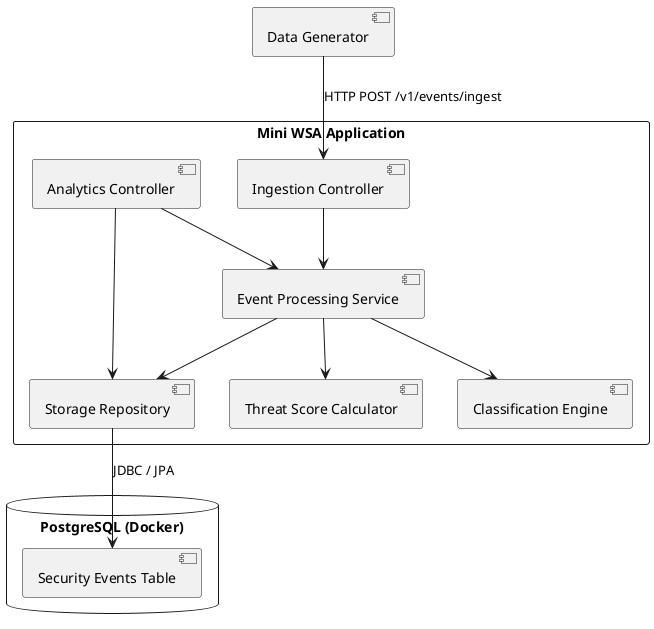
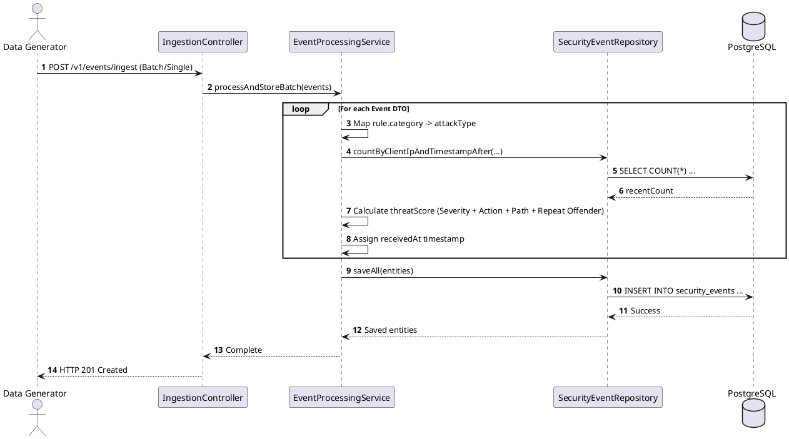

# Mini Security Analytics Pipeline — Implementation Blueprint

## Overview & Context

This document outlines my strategy, architecture choices, and step-by-step plan for completing the **Mini Web Security Analytics (Mini WSA)** take-home assignment.

The goal of this service is to mimic a core backend brain for a SOC (Security Operations Center) war room dashboard. It ingests raw DLR (Data Log Records) security events, enriches them on the fly (attack classification and dynamic threat scoring), persists them efficiently, and exposes statistics and sample data through REST APIs.

---

## Architectural Strategy & Choices

### 1. Technology Stack
* **Language/Framework:** Java 25+ with Spring Boot 3.x
    * Standard enterprise toolset offering robust web REST support, validation, and database abstraction layers.
* **API Documentation:** Springdoc OpenAPI (Swagger UI)
    * Provides interactive API documentation and auto-generated endpoints.
* **Database:** PostgreSQL running in Docker (`postgres:18-alpine`)
    * **Why PostgreSQL?** Security events consist of structured relational attributes (timestamps, status codes, action flags) alongside semi-structured JSON objects (rule metadata, geolocation details). PostgreSQL handles both structured relational joins and `JSONB` flexibility cleanly. It also supports indexing techniques (`btree` on timestamps and IPs) to keep aggregated analytics queries fast at scale.

### 2. High-Level Architecture

---

## Step-by-Step Implementation Roadmap

Below is the structured breakdown I am following to build, test, and deliver the system iteratively.

### Phase 1: Repository Setup & Foundation
* **Step 1.1:** Initialize the public GitHub repository and setup `.gitignore` for Java and IDE files.
* **Step 1.2:** Generate a Spring Boot base project containing `Spring Web`, `Validation`, `Spring Data JPA`, and `PostgreSQL Driver`.
* **Step 1.3:** Configure Springdoc OpenAPI / Swagger UI dependencies and verify UI initialization.
* **Step 1.4:** Create `docker-compose.yml` to spin up a PostgreSQL instance and define application properties (`application.yml`) to connect to it.
* **Milestone Commit Tag:** `v0.1-setup`

---

### Phase 2: Domain Models & Ingestion Layer
* **Step 2.1:** Design the `SecurityEvent` domain entities and request/response DTOs representing the DLR schema (including nested `Rule` and `GeoLocation` models).
* **Step 2.2:** Add Jakarta Validation annotations (`@NotNull`, `@Pattern`, custom enums) to enforce schema compliance on incoming requests.
* **Step 2.3:** Implement `POST /v1/events/ingest` supporting both single event objects and lists of events.
* **Step 2.4:** Inject server-side timestamp processing (`receivedAt`) onto incoming payloads prior to storage.
* **Milestone Commit Tag:** `v0.2-ingestion`

---

### Phase 3: Classification & Enrichment Logic
* **Step 3.1:** Implement category-to-attack-type mapping (`INJECTION` $\rightarrow$ "SQL/Command Injection", `XSS` $\rightarrow$ "Cross-Site Scripting", etc.).
* **Step 3.2:** Build the dynamic threat score evaluation algorithm (0 to 100 max score):
    * Base severity addition (`CRITICAL` +40, `HIGH` +30, `MEDIUM` +20, `LOW` +10).
    * Action adjustment (`DENY` +20, `ALERT` +10, `MONITOR` +0).
    * Target path bonus (+15 if path contains `/admin` or `/login`).
    * Repeat offender rule (+15 if > 5 events received from the same `clientIp` within the previous 10 minutes).
* **Step 3.3:** Persist fully enriched records into PostgreSQL.
* **Milestone Commit Tag:** `v0.3-enrichment`

---

### Phase 4: Analytics & Query APIs
* **Step 4.1:** Implement `GET /v1/stats/summary`:
    * Add filtering by `configId` and date range (`from` and `to`).
    * Calculate aggregated counts and average threat scores grouped by `category` and `action`.
    * Construct SQL queries to fetch the **Top 10 Attackers** (by `clientIp`) and **Top 10 Targeted Paths**.
* **Step 4.2:** Implement `GET /v1/events/samples`:
    * Build multi-criteria queries supporting optional filters (`configId`, `category`, `action`, time range).
    * Implement pageable offset and limit sorting descending by event timestamp.
* **Milestone Commit Tag:** `v0.4-analytics`

---

### Phase 5: Event Simulation & Data Generator
* **Step 5.1:** Construct a dedicated dataset generator (script or Spring component) capable of producing realistic security event streams.
* **Step 5.2:** Program simulation patterns for "attack waves" (bursts of events from single IP addresses hitting administrative endpoints) to validate repeat offender logic and top attacker stats.
* **Milestone Commit Tag:** `v0.5-generator`

---

### Phase 6: Testing, Refinement & Final Documentation
* **Step 6.1:** Write unit tests for threat score calculations, attack type mappings, and validation logic.
* **Step 6.2:** Write integration tests covering the ingestion and analytics API endpoints.
* **Step 6.3:** Benchmark queries and add PostgreSQL indexes on (`timestamp`, `received_at`, `client_ip`, `config_id`).
* **Step 6.4:** Finalize `README.md` with execution instructions, curl command examples, and key insights.
* **Final Tag:** `v1.0-release`

---

## Technical Pitfalls & Mitigation Strategies

1. **Repeat Offender Query Performance:**
    * *Challenge:* Checking event history for every ingested request can slow down throughput.
    * *Solution:* Index `(client_ip, timestamp)` in PostgreSQL to ensure the count check executes in milliseconds.
2. **Schema Flexibility vs. Aggregation Speed:**
    * *Challenge:* Storing nested data as raw JSON can make SQL aggregation slower.
    * *Solution:* Map heavily queried parameters (`clientIp`, `path`, `category`, `action`, `configId`) as top-level indexed table columns, storing optional deep attributes in `JSONB`.
3. **Data Quality & Validation Errors:**
    * *Challenge:* Batch payloads might contain mixed valid/invalid records.
    * *Solution:* Perform validation parsing up-front and return explicit 400 response detail arrays highlighting erroneous indexes or fields.

---

## How to Run locally

*(Will be updated during release)*
1. Start PostgreSQL: `docker compose up -d`
2. Access Swagger UI: `http://localhost:8080/swagger-ui/index.html`

## Design Decisions & Engineering Trade-Offs

*(Will be updated during release)*

### 1. Ingestion Payload Envelope (`/v1/events/ingest`)
* **The Assessment Requirement:** The prompt states that the endpoint should accept either a single event or a batch array.
* **The Real-World Challenge:** Supporting polymorphic inputs (both `SecurityEvent` and `List<SecurityEvent>`) in a single REST endpoint leads to messy parsing logic and makes schema evolution difficult, risking breaking changes for API consumers down the road.
* **Decision:** For this take-home assessment, I chose to implement a clean wrapper JSON payload (envelope pattern) rather than raw polymorphic arrays. In a true enterprise production environment, we would implement content-type negotiation or versioned endpoints (`/v1/events` vs `/v1/events/batch`), but the wrapper provides the best balance of safety and simplicity for this scope.

### 2. Error handling
* **Define proper error handling:** duplicates, inexistent configurations, etc. 